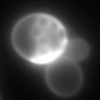
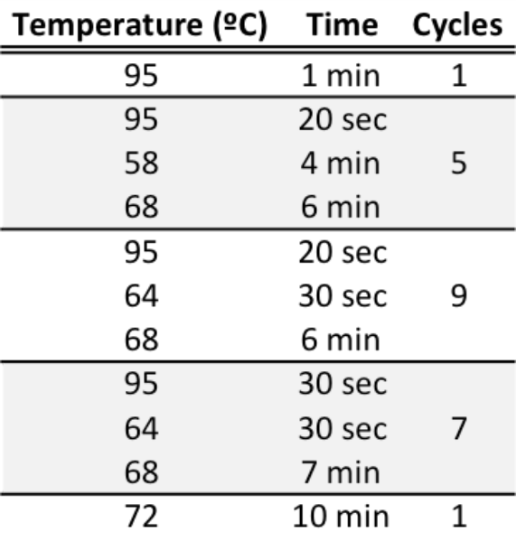
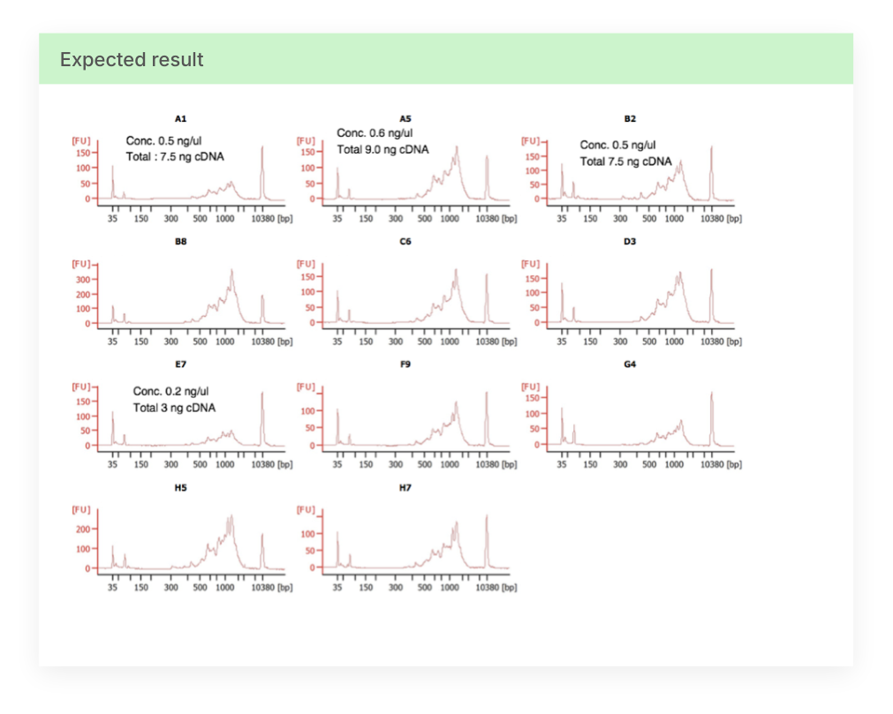
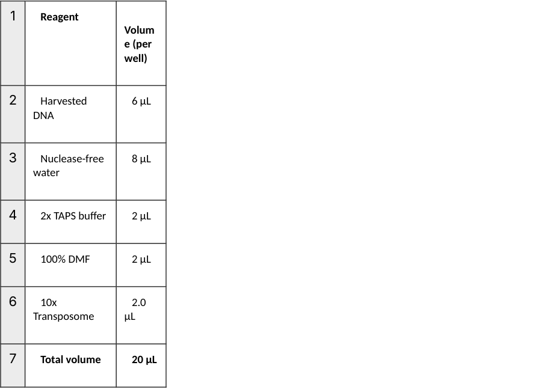
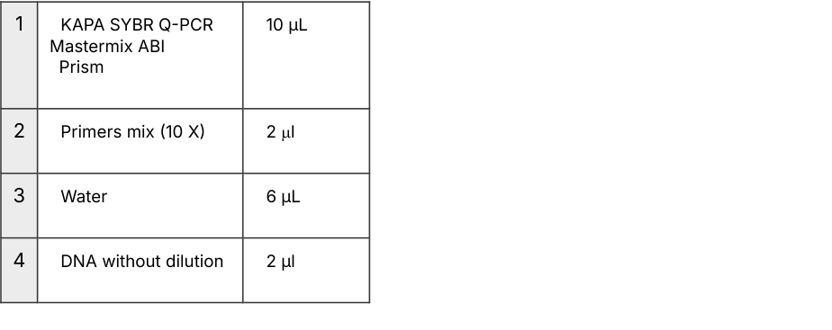
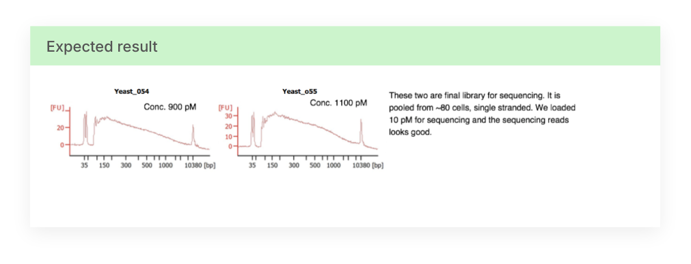

Dec 26, 2018 

# yeast single cell RNA-seq (yscRNA-seq) 

DOI 

https://dx.doi.org/10.17504/protocols.io.t29eqh6 

**[Image: yeast-single-cell-rna-seq-yscrna-seq-t29eqh6_-1-.pdf-0001-04.png (204x204, 21.6KB)]**

1 2 2 3 2 3 3 Mariona Nadal , Saiful Islam , Wu Wei , Pablo Latorre , Michelle Nguyen , Eulàlia e Nadal , Francesc Posas , 4 Lars M. Steinmetz 

> 1IRB Barcelona; 2Stanford Universtity, Stanford Genome Technology Center; 

> 3IRB Barcelona, Universtat Pompeu Fabra; 4Stanford Universtity, Stanford Genome Technology Center, EMBL 

Yeast Protocols, Tools, a… 

**[Image: yeast-single-cell-rna-seq-yscrna-seq-t29eqh6_-1-.pdf-0001-09.png (64x63, 0.9KB)]**

### Mariona Nadal-Ribelles 

IRB Barcelona 

### Create & collaborate more with a free account 

Edit and publish protocols, collaborate in communities, share insights through comments, and track progress with run records. 

Create free account 

**[Image: yeast-single-cell-rna-seq-yscrna-seq-t29eqh6_-1-.pdf-0001-15.png (158x40, 3.7KB)]**

**[Image: yeast-single-cell-rna-seq-yscrna-seq-t29eqh6_-1-.pdf-0001-16.png (173x173, 7.6KB)]**

##### DOI: <u>https://dx.doi.org/10.17504/protocols.io.t29eqh6</u> 

Protocol Citation: Mariona Nadal, Saiful Islam, Wu Wei, Pablo Latorre, Michelle Nguyen, Eulàlia e Nadal, Francesc Posas, Lars M. Steinmetz 2018. yeast single cell RNA-seq (yscRNA-seq). protocols.io <u>https://dx.doi.org/10.17504/protocols.io.t29eqh6</u> 

<u>protocols.io</u> | https://dx.doi.org/10.17504/protocols.io.t29eqh6 

December 26, 2018 

1/18 

License: This is an open access protocol distributed under the terms of the <u>Creative Commons Attribution License,</u> which permits unrestricted use, distribution, and reproduction in any medium, provided the original author and source are credited 

Protocol status: Working We use this protocol and it's working 

Created: September 27, 2018 

Last Modified: December 26, 2018 

Protocol Integer ID: 16193 

Keywords: yeast single cell RNA-seq (yscRNA-seq), transcriptomics, single cell rna, yscrna, rna, single cell, seq 

## Guidelines 

Please follow all precautions that usually you need to follow RNA and single-cell work. Clean the area prior to starting the protocol. Use dedicated reagents only to single cell work (and label them appropriately). Use pipettes and filter tips throughout the entire protocol** 

<u>protocols.io</u> | https://dx.doi.org/10.17504/protocols.io.t29eqh6 

December 26, 2018 

2/18 

## Cell growth 

- 1 Grow the desired pre-inoculum of your desired yeast strain in their corresponding media O/N. 

   - To profile exponentially growing cells, we recommend the initial culture not to grow over OD6601 

- 2 Next morning. Dilute your cells to OD660 0.05 in the corresponding media and allow for at least 2 cell divisions prior to sorting. 

## Single cell isolation by FACS sorting 

- 3 Prepare 96/384 well plates* containing 5 µL Absolute Ethanol** ineachtofixcells immediately from sorting 

   - During protocol optimization we recommend using break-away plates 

   - (EK75118 ). Check with your facility the compatibility of the plates. 

   - ** this is the minimum volume required for our sorting facility/plates. Check with your facility 

Note: We have obtained the same results sorting cells directly into 5 ul of cell capturing solution and lysis (see below). If doing so, prepare plates right before sorting and keep them on 4 °C ice 

- 4 Dilute cells prior to sorting to OD0.05 in 3 mLofmediaandvortexvigurosulyto separate cell clumps. 

   - At this step propidium idodide PI) can be added to check for cell viability 

- 5 At the FACS facility, filter cells with Cell Strainer Tubes (check with your facility which tubes they prefer) and put cells in the appropiate sorting tube for live single cell sorting. 

- 6 Check the alignment of the plate with the sorter. For example, this can be done by sorting a drop into a covered plate and look for the droplet would fall inside each well. 

<u>protocols.io</u> | https://dx.doi.org/10.17504/protocols.io.t29eqh6 

December 26, 2018 

3/18 

- 7 Sort live single yeast into the each well of the plates and leave one well (we ususally do H12 as empty/not sorted) asnegativecontrol. 

   - Should you want to do a positive control, sort 100 cells into one well (we usually do A1. 

- 8 Cover plates with aluminim seal if plates will not be processed right away or with temporary plastic lid. 

- 9 Quickly spin plates to collect cells at the bottom 

- 10 Let EtOH avaporate in a sterile environment (stril hood) for 004500 maximum 

- 11 Once EtOH is completely evaporated, add 5 µL yeast cell lysis solutuinofcell capturing solution and lysis. Spin down and freeze immediately. 

Regardless if cells are sorted into EtOH or cell capturing and lysis solution, frozen plates can be stored at 80ºC for at least 6 months. 

Cell lysis solution: 

|1|**Reagents**|**Reference**|Volu me 1 rxn)|
|---|---|---|---|
|2|1% Triton X-100|X100-1L|0.05|
|3|UMI_Oligo dT_T31**(**100M)|IDT|0.2|
|4|dNTP 25 mM|R0181|0.68|
|5|100 mM DTT|18064014|0.5|
|6|Zymolyase 100T (100 mg/ml)|37340-57- 1|0.6|
|7|RNase Inhibitor (40 U/ml)|2313A|0.12|
|8|RNase-Nuclease free H2O|10977035|2.769|

<u>protocols.io</u> | https://dx.doi.org/10.17504/protocols.io.t29eqh6 

December 26, 2018 

4/18 

|9|ERCC (1:1000,0000) (5000 molecules)|4456740|0.081|
|---|---|---|---|
|10|Total||5|

## Lysis reaction 

- 12 Do the follwoing lysis cycle from fresh sorted or frozen plates and quickly proceed to add RT reaction for 1st strand cDNA synthesis 

Incubate at 30ºC for at least 10 minutes * 

001000 

- 3 minutes at 72ºC 000300 

- 1 minutes at 4C 

- We have changed the length of cell lysis up to 30 minutes 

## 1st strand cDNA synthesis 

13 5 Add 5 µL Reverse transcription mix RT mix 

|1|Reagents|Volume 1 rxn)|Referen ce|
|---|---|---|---|
|2|5X SuperScript Stand Buffer|2|1806401 4|
|3|MgCl2 1M|0.06|AM9530 G|
|4|Betaine 5M|1.6|61962|
|5|UMI_TSO 100uM|0.2|IDT|
|6|200 U/ul SuperScript II|0.25|1806401 4|

<u>protocols.io</u> | https://dx.doi.org/10.17504/protocols.io.t29eqh6 

December 26, 2018 

5/18 

|7|RNase inhibitor 40U/ml|0.125|2313A|
|---|---|---|---|
|8|RNase-Nuclease free H2O|0.765|1097703 5|
|9|Total|5||

14 Spin down the plate and perform the following cycles 

42ºC for 90 mins 

70ºC for 15 mins 

4ºC forever 

014500 

## Library amplification 

### 15 Add 15 µL PCR mixforlibraryamplification 

|1|Reagents|Volume 1 rxn)|
|---|---|---|
|2|10X Advantage 2 PCR buffer|2.5|
|3|dNTPs 25mm|0.4|
|4|UMI_PCR 10uM|1.2|
|5|50X Advantage 2 polymerase mix|0.5|
|6|H20|10.4|
|7|Total|15|

- 16 Spin down the plate and do the following cycles 

<u>protocols.io</u> | https://dx.doi.org/10.17504/protocols.io.t29eqh6 

December 26, 2018 

6/18 

**[Image: yeast-single-cell-rna-seq-yscrna-seq-t29eqh6_-1-.pdf-0007-00.png (571x599, 70.3KB)]**

hold at 4ºC overnight (if necessary). This is usually a safe stopping point 

## qPCR validation 

- 17 Perform a 120 dilution of the amplified library to check the percentage of positive libraries. 

Use your favorite protocol, and use as a target primers to a housekeeping gene or ERCCs. 

This step is specially useful during the protocol set up as it allows to isnpect the efficiency of the protocol before moving forward. 

|1|Reagent|Volume (μl)|
|---|---|---|
|2|Sybergreen 2X|2.5|
|3|Primer mix*|0.125|
|4|H2O|1.375|
|5|DNA|1|

* Primer mix is a mmix of Fw and Rv primer 10µM each) 

<u>protocols.io</u> | https://dx.doi.org/10.17504/protocols.io.t29eqh6 

December 26, 2018 

7/18 

- 1 cycle: 95ºC 10 min 

- 40 cycles: 95ºC 30 sec, 58ºC 30 sec and 72ºC 30 sec 

- 1 cycle: 95ºC 15 sec, 60ºC 15 sec and 95ºC 15 sec (melting curve) 

Primer sequence for qPCR 

SOMN17 Fw_TDH3_probe TCGTCAAGTTGGTCTCCTGG SOMN18 Rv_TDH3_probe GGCAACGTGTTCAACCAAGT SOMN21 Fw_ADH1_probe TGGTGCCAAGTGTTGTTCTG 

SOMN22 Rv_ADH1_probe GGCGAAGAAGTCCAAAGCTT SOMN310 Fw_5_ERCC_00130 CGGAAAAGTACTGACCAGCG SOMN311 Rv_5_ERCC_00130 TGCCAATGACTTCAGCTGAC 

A good plate will have around 70% positive wells, as far as itʼs around 50% it should be OK. Rearrange positive cells into a new plate to proceed to tagmentation. 

## dscDNA library clean up 

- 18 Before commencing the purification steps, equilibrate Ampure XP beads at room temperature for 15 min, and then vortex well for several seconds. 

   - Add 15 µL Ampure XP beads10.6ratio)toeachsample(eachtubemighthave slightly different volumes due to evaporation). 

   - Do not increase the volume of beads in the purification step above the 11 ratio. A lessthan-standard amount of beads ensures that primer dimer carryover is kept to a minimum. 

- 19 Mix by pipetting up and down ten times or until the solution appears homogeneous. Transfer solutions to a 96-well plate with compatible magnet stand 

- 20 Incubate the mixture for 10 min at room temperature to let the DNA bind to the beads. 001000 

- 21 Place the 96-well plate on the magnetic stand for 5 min or until the solution is clear and the beads have been collected 000500 

- 22 While samples are on the magnet, carefully remove the liquid without disturbing the beads. 

<u>protocols.io</u> | https://dx.doi.org/10.17504/protocols.io.t29eqh6 

December 26, 2018 

8/18 

- 23 Wash the beads with 200 l of 80% (vol/vol) ethanol solution. Incubate the samples for 30 sec and then remove the ethanol. 

It is important that the ethanol solution is freshly prepared every time, as ethanol absorbs moisture from the environment, thus changing the final concentration. Repeat ethanol washing. 

- 24 Repeat ethanol washing one more time. 

- 25 Remove any trace of ethanol and let the beads dry completely, leaving the plate at room temperature for 5 min or until a small crack appears on the surface of the beads. 

   - Avoid over drying the beads because this will make their resuspension in the designated buffer more difficult. 

   - ** As a precaution, cover the plate during this step or protect it from any possible source of contamination or air flows that might disperse the beads around the well, thus leading to cross-contamination between adjacent wells especially. 

- 26 When beads are dried, elute dscDNA libraries with 

      - 16.5 µL elution buffer EB buffer Qiagen)( <u>19086)</u> 

- 27 Remove plate from the magnet and mix vigurously by pipetting up and down x3 times to resuspend beads out of the magnet 

- 28 Place the plate on the magnetic stand and leave it for 2 min or until the solution appears clear and beads have accumulated in a corner of the well. 000200 

- 29 Recover 15 ml of SPN from each well and transfer to a new plate. Label correctly as this plate will be stored. 

SAFE STOPPING POINT: cDNA llibraries can be stored at 20ºC before proceeding to tagmentation. 

## dscDNA library/concentration size validation 

- 30 Run 1 µLofseveralpurifieddscDNAlibrariestocheckthesizedistributionand estimate of concentrations using a High Sensitivity DNA ChIP 2100 Bioanalyzer). qPCR 

<u>protocols.io</u> | https://dx.doi.org/10.17504/protocols.io.t29eqh6 

December 26, 2018 

9/18 

validation using a housekeeping gene is valuable to guide well selection. Always run your negative control. 

**[Image: yeast-single-cell-rna-seq-yscrna-seq-t29eqh6_-1-.pdf-0010-01.png (1011x809, 199.1KB)]**

<!-- Start of picture text -->
Expected result <!-- End of picture text -->

## Adaptor annealing for tagmentation 

- 31 In order to load Tn5 with cell-specific adaptors, these need to be annealed as dsDNA cell-specific adaptors. 

   - To anneal the adapters mix in a 96 well plate: 

Mix UMITN5U 100 µM) and UMITN5_1 (µM) to 96 in TE 1X to final concentration 50 µM (each), a 11 dilution. 

Primer annealing thermocycler: 95ºC for 3 minutes and gradually cool down to room temperature 0,5 ºC/sec). 

<u>protocols.io</u> | https://dx.doi.org/10.17504/protocols.io.t29eqh6 

December 26, 2018 

10/18 

This plate can be stored at 20ºC for several months and used to lead several rounds of Tn5. 

## Tn5 loading with cell-specific adaptors 

32 Prepare the following mix and aliquot , 

Prepare the following mix and aliquot 8.75 µLofthemix(exceptforadapters)intoa new 96 well plate. Then add 1.25 µLofeachadaptortoeachwell. 

|1|**Reagent**|**Volume**|Observations|
|---|---|---|---|
|2|50 µM adapter (96 different)|1.25 µL|add this later individually to each well|
|3|80% Glycerol|6.25 µL||
|4|50 µM Tn5 transposase|1.25 µL|Hennig, Bianca P., et al. "Large-Scale Low-Cost NGS Library Preparation Using a Robust Tn5 Purification and Tagmentation Protocol." G3 Genes, Genomes, Genetics 2017 g3 300257.|
|5|Nuclease-free water|1.25 µL||
|6|**Total volume**|**10 µL**||

33 Incubate 37°C for one hour and freeze 20 °Cifnotgoingtobeusedrightaway. 010000 

* Note, this Tn5-loaded plate can be safely stored for a 12 weeks at 20 °C. However leaving the loaded plate on ice 4 °CwillsignificantlyreduceTn5activity and will result in inefficient tagmentation. 

<u>protocols.io</u> | https://dx.doi.org/10.17504/protocols.io.t29eqh6 

December 26, 2018 

11/18 

## Tagmentation 

- 34 Prepare the following mix 

**[Image: yeast-single-cell-rna-seq-yscrna-seq-t29eqh6_-1-.pdf-0012-02.png (924x647, 25.7KB)]**

<!-- Start of picture text -->
1 Reagent Volum e (per well) 2 Harvested  6 µL DNA 3 Nuclease-free  8 µL water 4 2x TAPS buffer 2 µL 5 100% DMF 2 µL 6 10x  2.0 Transposome  µL 7 Total volume 20 µL <!-- End of picture text -->

35 Incubate for 55ºC for 5 min → 3 min 85ºC to inactivate Tn5 and then cool to 4 °C 

#### 000500 

- The tagmentation time can vary depending on the Tn5 purification batch. 

## 5' capture through Streaptavidin beads 

36 Do a 120 dilution of MyOne Streptavidin for the total number of samples ( 

1 µL of beads/sample). 

Example: 20 µL beadsfor20samples) 

<u>protocols.io</u> | https://dx.doi.org/10.17504/protocols.io.t29eqh6 

December 26, 2018 

12/18 

#### 2XBWT Buffer: 

10 mM Tris-HCl pH7.5 

1mM EDTA 2M NaCl 

0.02% Tween-20 

- 37 Wash MyOne beads x2 with 2XBWT buffer and resupsend with 20X more volume than the original volume of beads with 2XBWT 

Example: 20 µL beadsfor20samples,willbefinallyresuspendedwith 400 µL 2XBWT 

- 38 Add 20 µL beads to each well and incubate at RT for 5 min at room temprature 000500 

39 Pool all samples into a single collecting tube 1.5 or 2 ml) 

- 40 Place collecting tube in magnetic rack and allow time enough for the solution to be completely clear 

41 Wash beads once with TNT buffer 100 µL 

TNT Buffer: 

20 mM Tris pH 7.5 50 mM NaCl, 0.02% Tween 

42 Wash the beads once in Qiaquick PB 100 µLdiscardSPN 

43 Wash beads 3x with TNT buffer 100 µLagain,discardSPN 

## Removing 3' end fragments 

44 Resuspend the beads in the following mix: 

<u>protocols.io</u> | https://dx.doi.org/10.17504/protocols.io.t29eqh6 

December 26, 2018 

13/18 

|1|**Reagent**|**Volum** **e**|
|---|---|---|
|2|CutSmart buffer|10 µL|
|3|PvuI-HF enzyme (20 U/µL)|2 µL|
|4|Nuclease-free water|88 µL|
|5|**Total volume**|**100** **µL**|

- 45 Incubate at 37°C for one hour with interval mix during the incubation (to avoid beads precipitation); 2 min without mix, 30 sec 1000 rpm mix. 010000 

46 Wash the beads three times in TNT. 100 µL 

## Eluting single stranded cDNA library 

- 47 Resuspend in 30 µL Nuclease-free water. 30 µL 

- 48 Incubate 10 min at 70°C, 850 rpm mix. 001000 

- 49 Bind the beads to the magnet <u>immediately</u> and collect the supernatant. 

<u>protocols.io</u> | https://dx.doi.org/10.17504/protocols.io.t29eqh6 

December 26, 2018 

14/18 

## sscDNA cleanup 

- 50 Add 54µl of room temperature Ampure XP beads to 30µ sscDNA library 54 µL Ampure XP beads 

- 51 Incubate 10 min at RT. 001000 

- 52 Bind the beads to the magnet for 1min and discard supernatant or until solution is completely clear. 

   - 000100 

- 53 Wash once with 200 µL fresh 80% ethanol for 2030 sec. Let the beads be bound to the magnet the entire time. 

- 54 Dry the beads for up to 2 min. 000200 

- 55 Resuspend in 30 µL Qiagen EB buffer and incubate 5 min at RT. 000500 30 µL EB 

- 56 Bind the beads 1 min and transfer SPN to a new tube. 

## Library Concentration 

- 57 To quantify library concentration, set up a KAPA quantification reaction with a 1100 and 11000 dilutions of the eluted cDNA library. 

|1|Reagent|Volume 1 rxn)|
|---|---|---|
|2|KAPA SYBR®FAST qPCR Master Mix containing Primer Premix|12 µl|
|3|PCR-grade water|4 µ|
|4|Diluted library DNA or DNA Standard|4 µl|

<u>protocols.io</u> | https://dx.doi.org/10.17504/protocols.io.t29eqh6 

December 26, 2018 

15/18 

5 TOTAL 20 µl 

This kit can be subsituted by your favorite quantification method or by a qPCR using P5 P7 primer pairs with known standards PhiX is strongly recommended) sybergreen 2X mastermix. 

- 58 qPCR cycling conditions for KAPA and homemade Sybergreen 

|1|Tem pera ture|Time||
|---|---|---|---|
|2|95º C|5 min||
|3|95º C|30 sec|repeat this for 30 cycles for qPCR quantification|
|4|60º C|45 sec||
|5|4ºC|hold||

- 59 Use the qPCR to calculate library quantification using the template provided by <u>KAPA biosystems</u> or the instructions provided from your manufacturer. We have used KAPA, NEB and homemade systems with similar results. 

## Library Size 

### 60 

Sett up a separate PCR to run a bioanalyzer to determine the final size distribution. Prepare the following mix: 

**[Image: yeast-single-cell-rna-seq-yscrna-seq-t29eqh6_-1-.pdf-0016-08.png (924x367, 17.9KB)]**

<!-- Start of picture text -->
1 KAPA SYBR QPCR 10 µL Mastermix ABI Prism 2 Primers mix 10 X 2 l 3 Water 6 µL 4 DNA without dilution 2 µl <!-- End of picture text -->

<u>protocols.io</u> | https://dx.doi.org/10.17504/protocols.io.t29eqh6 December 26, 2018 

16/18 

**[Image: yeast-single-cell-rna-seq-yscrna-seq-t29eqh6_-1-.pdf-0017-00.png (1185x238, 5.0KB)]**

<!-- Start of picture text -->
5 Total volume 20 µl <!-- End of picture text -->

- 61 Run the same PCR as in step 58 but for 11 cycles 

- 62 Run 1 µL into a High sensitivity DNA CHIP to obtain an average library size based on the Bioanalyzer profile. 

**[Image: yeast-single-cell-rna-seq-yscrna-seq-t29eqh6_-1-.pdf-0017-03.png (1011x388, 58.1KB)]**

<!-- Start of picture text -->
Expected result <!-- End of picture text -->

## Sequencing 

- 63 Sequence the library on the HiSeq 2000 High output using C1P1PCR2 as the Read 1 primer and UMITN5U as the Index read primer. 

- 64 To run the libraries on the HiSeq rapid run, us LNA primers. Spike in at primer at 0.5 uM. Index 1 primer into HP8 (position 17) in the HiSeq Read 1 primer into HP9 (position 16) in the Hiseq 

   - (double check this information with your sequencing kit/instrument) 

UMI_PCR_read1 GAATGATACGGCGACCA CCGAT - custom 250 nmole. DNA oligo, HPLC Purification 

Index1 CTGTCTCTTATACA CATCTGACGC - custom 250 nmole DNA oligo, HPLC Purification 

- Note for High Output run custom primers are needed as well but without LNA 

<u>protocols.io</u> | https://dx.doi.org/10.17504/protocols.io.t29eqh6 

December 26, 2018 

17/18 

65 Load around 814 pmol of each library per lane. Libraries are single stranded DNA, so no denaturing is required. 

<u>protocols.io</u> | https://dx.doi.org/10.17504/protocols.io.t29eqh6 

December 26, 2018 

18/18 

---

## Extracted Images

| # | File | Dimensions | Size |
|---|------|------------|------|
| 1 | yeast-single-cell-rna-seq-yscrna-seq-t29eqh6_-1-.pdf-0001-04.png | 204x204 | 21.6KB |
| 2 | yeast-single-cell-rna-seq-yscrna-seq-t29eqh6_-1-.pdf-0001-09.png | 64x63 | 0.9KB |
| 3 | yeast-single-cell-rna-seq-yscrna-seq-t29eqh6_-1-.pdf-0001-15.png | 158x40 | 3.7KB |
| 4 | yeast-single-cell-rna-seq-yscrna-seq-t29eqh6_-1-.pdf-0001-16.png | 173x173 | 7.6KB |
| 5 | yeast-single-cell-rna-seq-yscrna-seq-t29eqh6_-1-.pdf-0007-00.png | 571x599 | 70.3KB |
| 6 | yeast-single-cell-rna-seq-yscrna-seq-t29eqh6_-1-.pdf-0010-01.png | 1011x809 | 199.1KB |
| 7 | yeast-single-cell-rna-seq-yscrna-seq-t29eqh6_-1-.pdf-0012-02.png | 924x647 | 25.7KB |
| 8 | yeast-single-cell-rna-seq-yscrna-seq-t29eqh6_-1-.pdf-0016-08.png | 924x367 | 17.9KB |
| 9 | yeast-single-cell-rna-seq-yscrna-seq-t29eqh6_-1-.pdf-0017-00.png | 1185x238 | 5.0KB |
| 10 | yeast-single-cell-rna-seq-yscrna-seq-t29eqh6_-1-.pdf-0017-03.png | 1011x388 | 58.1KB |
